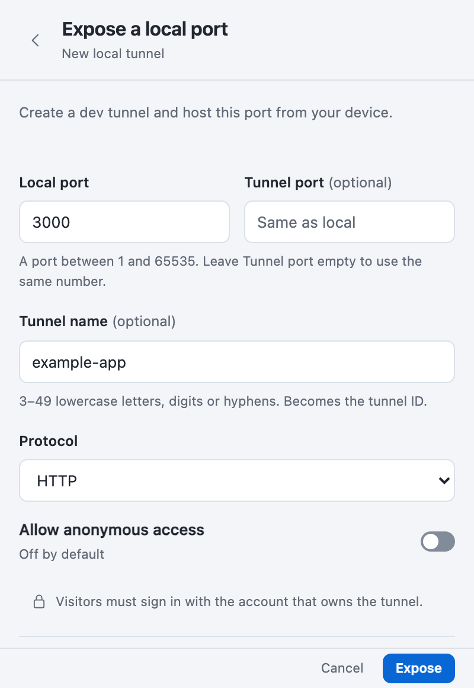
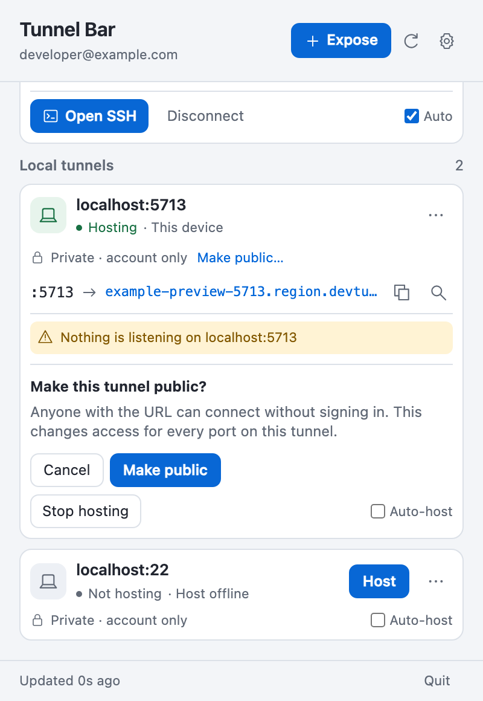
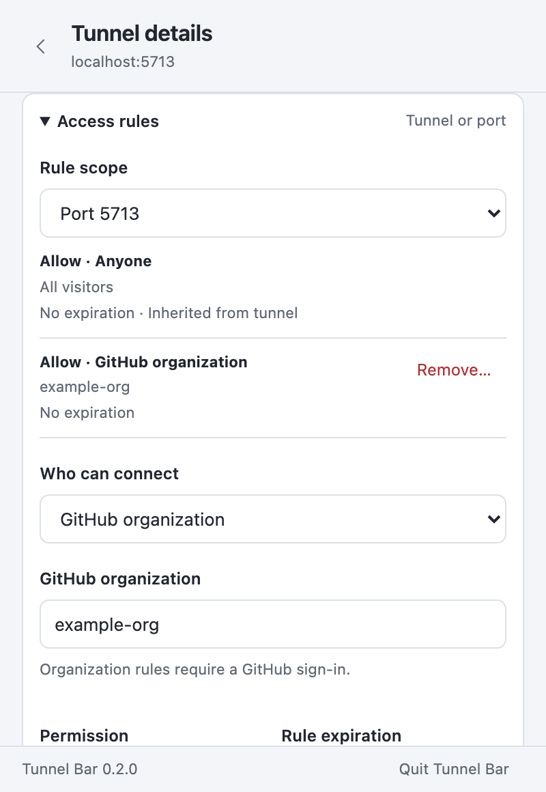
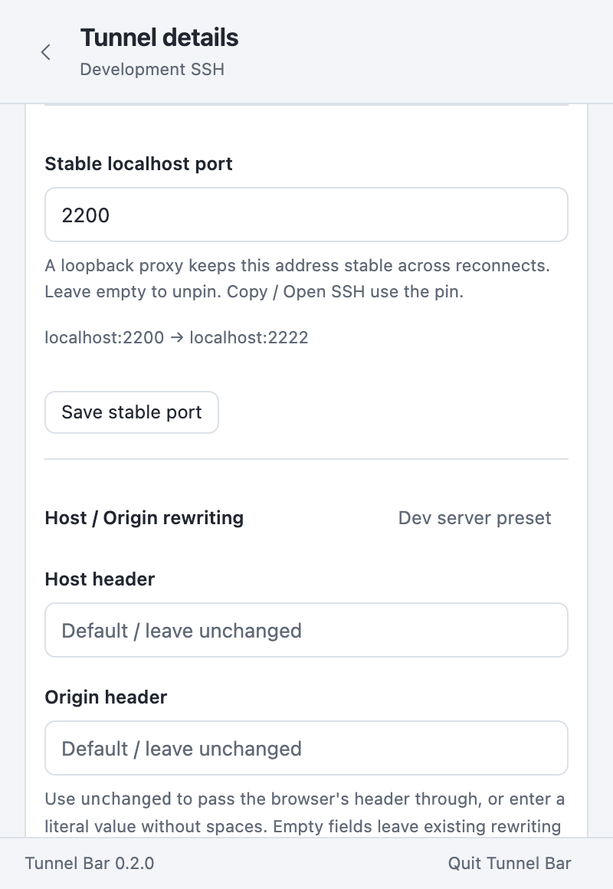
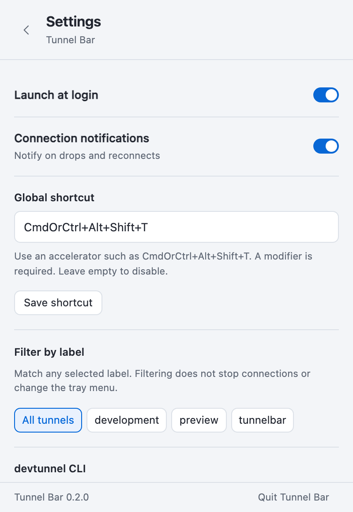
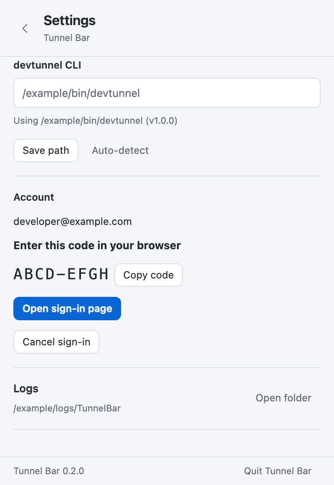
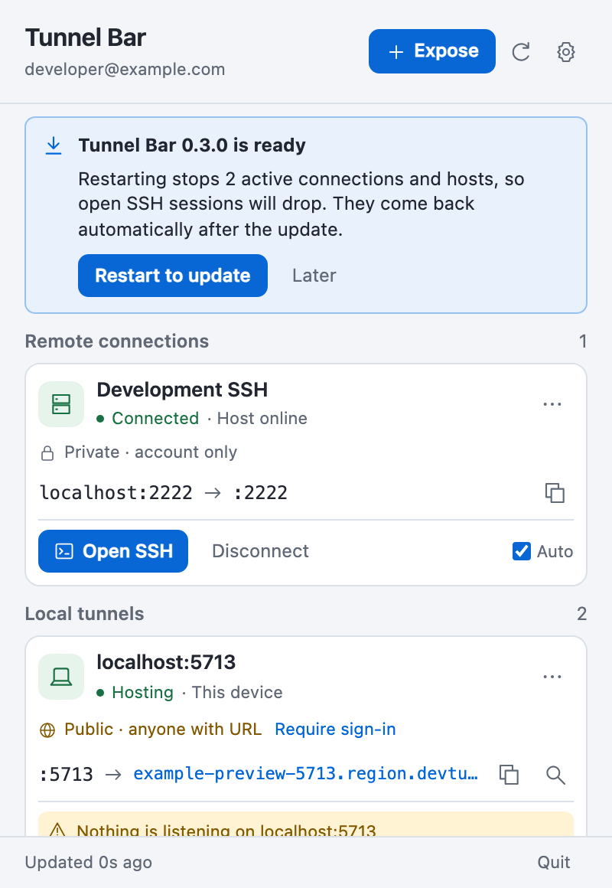
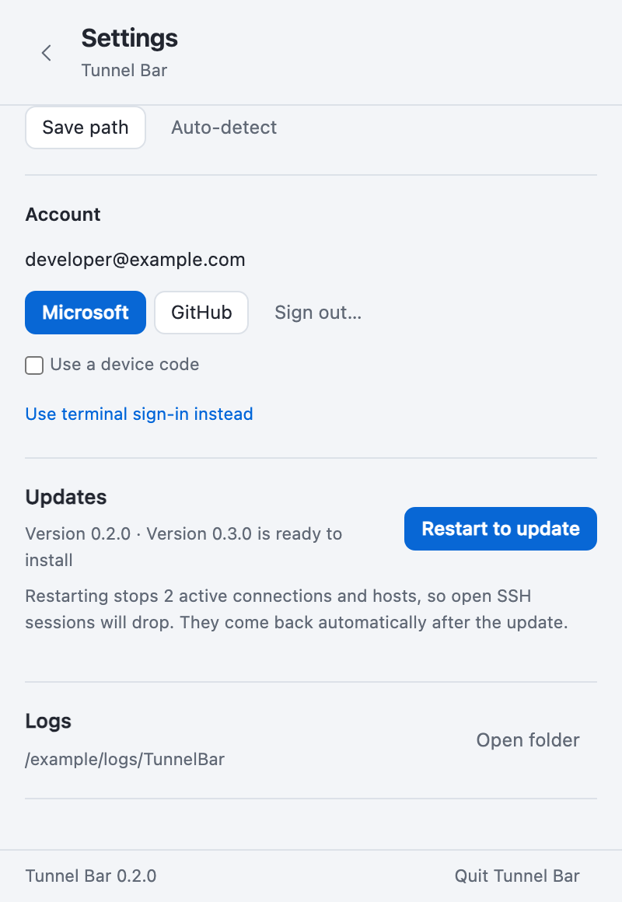
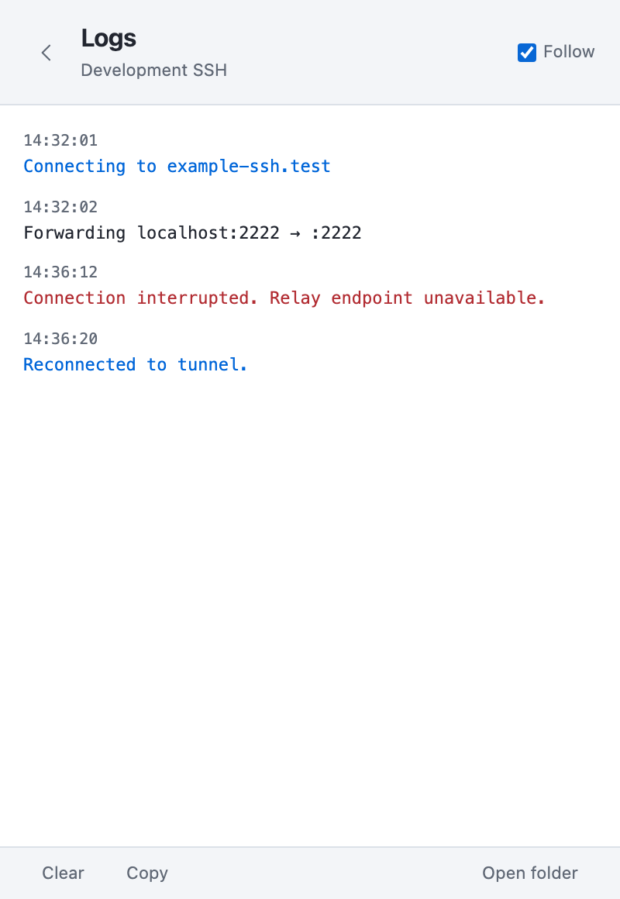
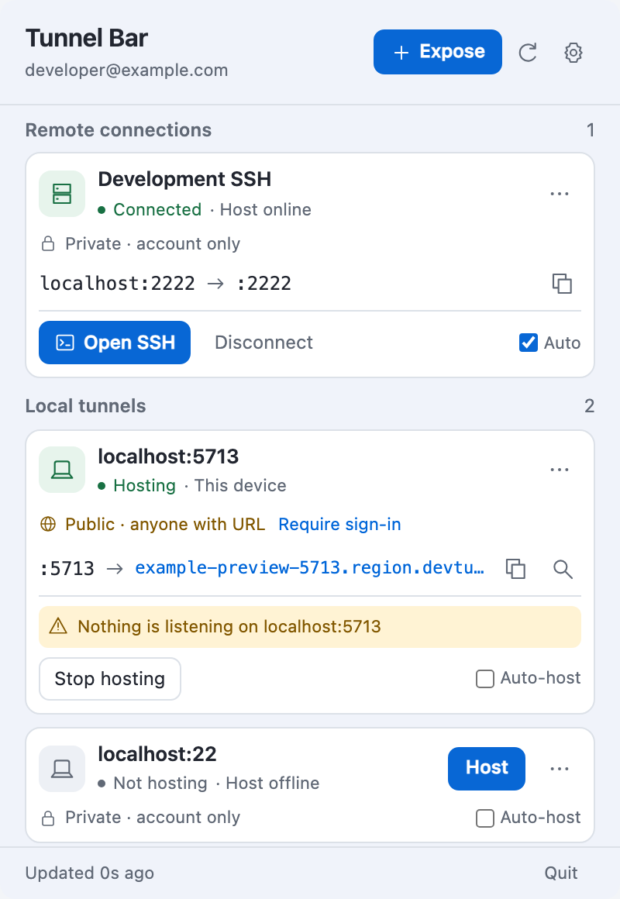

<p align="center">
  
</p>

# Tunnel Bar

A macOS menu-bar and Windows tray app for managing [Microsoft Dev Tunnels](https://learn.microsoft.com/azure/developer/dev-tunnels/): connect to tunnels and host your own. It wraps the `devtunnel` CLI, so it uses your existing CLI sign-in.

## Features

### Connecting

- Browse your account's tunnels in **Remote connections** and **Local tunnels**, with host online/offline status.
- Connect and disconnect, with auto-reconnect using exponential backoff. Stops retrying on auth errors.
- Per-tunnel **Auto** connect on launch. It's disabled (setting kept) while this device hosts the tunnel, since connecting would loop back to its own host.
- Detects `devtunnel connect` and `devtunnel host` processes started outside Tunnel Bar, with **Take over** and **Stop**. An external host gets Take over and Stop on its **Local tunnels** card only. On Windows, a `devtunnel host` started from an admin terminal is still recognised. Stopping it asks for administrator approval (UAC).
- Shows forwarded ports (`localhost:L → :R`), with Copy SSH (uses your `~/.ssh/config` alias if one matches) and Open SSH (Terminal on macOS, Windows Terminal or cmd on Windows).
- Recognises tunnels hosted on this device, by Tunnel Bar or another `devtunnel host`. Their **Remote connections** card says **This device** instead of offering Connect. It remembers the last host, so an offline tunnel shows "last hosted here".
- Optional local nicknames (double-click a tunnel name or open its details).
- Never orphans connections: stops children on Quit/SIGTERM, and reclaims any left by a crash on next launch. On Windows each child runs in a Job Object, so it dies with Tunnel Bar.

<picture>
  <source media="(prefers-color-scheme: dark)" srcset="docs/screenshots/main-dark.png">
  
</picture>

### Hosting

- **Expose a local port**: creates a tunnel labelled `tunnelbar`, adds the port (http/https/auto), and hosts it from this machine. An optional Tunnel port can advertise a different number, such as `:2222 → localhost:22`.
- **Host here** / **Stop hosting** for your own tunnels, with optional **Auto-host** on launch and auto-restart. Auto-host is disabled, with a tooltip saying why, while another process or device hosts the tunnel or it isn't on your account.
- Shows each hosted port's public URL (open/copy) and Inspect link, and warns when nothing is listening locally.
- Access control: private (your account) by default; **Make public…** adds anonymous access after confirmation; **Require sign-in** removes it.
- Delete tunnels after inline confirmation. Tunnels hosted by another machine require a separate, deliberate override; hosting them here stays disabled.

<picture>
  <source media="(prefers-color-scheme: dark)" srcset="docs/screenshots/expose-dark.png">
  
</picture>
<picture>
  <source media="(prefers-color-scheme: dark)" srcset="docs/screenshots/public-confirmation-dark.png">
  
</picture>

### Management

- Use **Manage** after creation to edit a tunnel's description, labels and expiration (1h–30d), and view its lifetime.
- Add and remove ports. Tunnel Bar restarts its host so the change takes effect.
- Access rules beyond public: your Entra tenant, a GitHub organization (needs a GitHub sign-in) or a repository, as allow or deny rules with an optional expiration, on the tunnel or a single port. Changing rules on a tunnel Tunnel Bar didn't create needs confirmation.
- Host/Origin header rewriting per tunnel or port, including `unchanged` for dev servers like Vite and Next.js.
- **Port mapping when hosting**: advertise a different tunnel port than the local one (e.g. 2222 → `localhost:22`). `devtunnel host` can't do this itself, so Tunnel Bar runs a loopback proxy on the tunnel port while it hosts.
- Deleting a tunnel Tunnel Bar didn't create needs explicit confirmation; a tunnel hosted by another machine also needs a separate override.
- **Stable local ports**: pin a remote port to a fixed `localhost` port. Tunnel Bar runs a small loopback proxy to whichever port `devtunnel connect` picked. A static `~/.ssh/config` `Port` then keeps working across reconnects, and Copy/Open SSH use the pin.

See [docs/phase3-ui-hooks.md](docs/phase3-ui-hooks.md) for the commands and fields.

<picture>
  <source media="(prefers-color-scheme: dark)" srcset="docs/screenshots/access-rules-dark.png">
  
</picture>
<picture>
  <source media="(prefers-color-scheme: dark)" srcset="docs/screenshots/ports-and-pins-dark.png">
  
</picture>

### Settings and sign-in

- Launch at login and notifications on unexpected drops and reconnects.
- Configure or disable the global popover hotkey (default ⌘⌥⇧T on macOS; Ctrl+Alt+Shift+T on Windows), and filter tunnels by label without stopping connections.
- Auto-detect the `devtunnel` CLI or set its path. Sign in with Microsoft or GitHub using a browser or device code; sign out after inline confirmation.
- Settings live in `~/Library/Application Support/me.svv.tunnelbar/` (`%APPDATA%\me.svv.tunnelbar` on Windows).

<picture>
  <source media="(prefers-color-scheme: dark)" srcset="docs/screenshots/settings-dark.png">
  
</picture>
<picture>
  <source media="(prefers-color-scheme: dark)" srcset="docs/screenshots/sign-in-device-code-dark.png">
  
</picture>

### Updates

Tunnel Bar checks GitHub Releases at launch and every few hours, downloads a new version in the background and verifies its signature. It never restarts on its own: when the update is ready, a banner explains that restarting drops active connections and hosts, such as open SSH sessions. Choose **Restart to update** or **Later**; Later leaves an "Update ready" pill in the footer. Connections and hosts that were running, plus auto-connect and auto-host tunnels, come back after the restart. Settings shows the current version and a **Check for updates** button. Development builds don't update.

<picture>
  <source media="(prefers-color-scheme: dark)" srcset="docs/screenshots/update-ready-dark.png">
  
</picture>
<picture>
  <source media="(prefers-color-scheme: dark)" srcset="docs/screenshots/settings-update-ready-dark.png">
  
</picture>

### Logs

Follow per-tunnel live logs from tunnel details, with timestamps, highlighted errors, Copy and Clear controls. Open the saved logs folder from the viewer or Settings: `~/Library/Logs/TunnelBar/` on macOS, `%LOCALAPPDATA%\TunnelBar\logs` on Windows.

<picture>
  <source media="(prefers-color-scheme: dark)" srcset="docs/screenshots/logs-dark.png">
  
</picture>

### Windows

The tray flyout shares the same connection, hosting and management controls, with light/dark styling and taskbar-theme-aware tray icons. Open SSH uses Windows Terminal or cmd; supervised CLI children run in Job Objects so they stop when Tunnel Bar exits.

<picture>
  <source media="(prefers-color-scheme: dark)" srcset="docs/screenshots/windows-main-dark.png">
  
</picture>

### Interface

- Separate **Remote connections** and **Local tunnels** groups, with explicit private/public access.
- Port tools remain beside their address; long URLs truncate without wrapping buttons.
- Tunnel details contain IDs, rename, logs, and secondary actions. Public access and deletion require inline confirmation.
- A single feedback dock shows brief copy/save confirmations and persistent, actionable errors without covering controls.
- Shared light/dark styling, keyboard focus, and reduced-motion support. App and tray icons are unchanged.
- See [the design refresh plan](docs/design-refresh-plan.md) for scope and validation.

## Requirements

- macOS 11+, or Windows 10/11 (WebView2 is installed by the installer if missing)
- `devtunnel` CLI (`brew install --cask devtunnel` / `winget install Microsoft.devtunnel`); sign in within Tunnel Bar or with `devtunnel user login`

## Install

Download the DMG from [Releases](https://github.com/svanvliet/tunnel-bar/releases) and drag Tunnel Bar to Applications. macOS builds are signed with a Developer ID and notarized, so they open without Gatekeeper warnings. After that, Tunnel Bar updates itself (see [Updates](#updates)).

On Windows, download `Tunnel-Bar_<version>_x64-setup.exe` (per-user NSIS) or the `.msi` installer from [Releases](https://github.com/svanvliet/tunnel-bar/releases) and run it. Builds aren't code-signed yet, so SmartScreen may ask you to confirm. Windows doesn't auto-update yet; install new versions from Releases. The manual (`workflow_dispatch`) CI `windows` job uploads both as the `tunnel-bar-windows` artifact.

## Build

```sh
npm ci
npm run tauri dev     # development
npm run tauri build   # release .app in src-tauri/target/release/bundle/macos
codesign --force --deep -s - src-tauri/target/release/"bundle/macos/Tunnel Bar.app"   # ad-hoc sign
./scripts/package-macos.sh   # signed + notarized universal DMG, zip, updater tarball and latest.json in dist/
```

`package-macos.sh` needs the Developer ID certificate, a `notarytool` keychain profile and the updater signing key; see `AGENTS.md` for the release flow. `SKIP_NOTARIZE=1` skips notarization for local packaging.

On Windows, `npm run tauri build` produces NSIS and MSI installers in `src-tauri/target/release/bundle/{nsis,msi}` (see `src-tauri/tauri.windows.conf.json`).

### Icon artwork

The editable app icon is `design/icon.svg`; tray state sources are in
`design/tray/`. To regenerate the README image, favicon, monochrome macOS
templates, outlined Windows tray images, and Tauri platform icons, install
`rsvg-convert` (`brew install librsvg`), then run:

```sh
node design/render-icons.mjs
```

macOS uses black-and-alpha templates at 36px (18pt at 2x), including the error
badge. Windows uses a black symbol with a white edge so it remains readable on
light and dark taskbars. A hollow server means disconnected, a dashed route
means connecting/retrying, a filled server means connected, and an exclamation
badge means attention is needed.

## Test

```sh
cd src-tauri
cargo test                         # unit + fake-CLI supervisor tests
cargo clippy --all-targets -- -D warnings
TUNNELBAR_LIVE_TUNNEL=<tunnel-id> cargo test live_connect -- --ignored --nocapture   # real CLI
TUNNELBAR_LIVE_HOST=<tunnel-id> cargo test live_host -- --ignored --nocapture   # tunnel with an http port served locally
cargo test live_manage -- --ignored --nocapture   # creates/edits/hosts/pins/deletes a temporary tunnelbar-test-* tunnel (1h expiry)
cd .. && npm run check
```

## Debug environment variables

| Variable | Effect |
| --- | --- |
| `TUNNELBAR_TRACE=1` | (debug builds) print each state snapshot to stderr |
| `TUNNELBAR_PIN=1` | keep the popover open when it loses focus |
| `TUNNELBAR_LIVE_TUNNEL` | tunnel id for the ignored live integration test |
| `TUNNELBAR_LIVE_HOST` | tunnel id for the ignored live hosting test |
| `TUNNELBAR_UPDATE_ENDPOINT` | (build time) replace the update endpoint; also enables updates in debug builds. Test builds only |
| `TUNNELBAR_TEST_PROFILE` | (build time) separate settings, logs and pidfiles (`me.svv.tunnelbar.<name>`, `TunnelBar.<name>`) and skip launch-at-login, so a test build runs beside the installed app |
| `TUNNELBAR_TEST_AUTO_INSTALL=1` | (runtime, test-profile builds only) install and restart as soon as an update is downloaded |

## Roadmap

1. ~~Phase 1 – connection management MVP~~ (v0.1.0)
2. ~~Phase 2 – hosting (`devtunnel host`) from the menu bar~~ (v0.2.0)
3. Phase 3 – tunnel management (create, delete, ports, labels, expiration, sign-in, stable ports, hotkey, label filter)
4. Phase 4 – Windows tray version: builds and runs on a PC; fixes in progress
5. Phase 5 – ~~signed/notarized DMG, auto-update~~, CI releases
